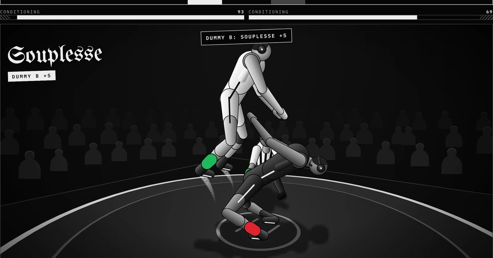

> **License:** source-available, view and learn only. Not open source. See [LICENSE](LICENSE) before cloning, forking or using this code.

# Folkstyle

An arcade wrestling game in the browser. Your sticks are your hands, your triggers are your hips, your bumpers grab wrists.

**Play:** [ag0nyy-ops.github.io/wrestle](https://ag0nyy-ops.github.io/wrestle/) · **Move index:** [all 139 moves](https://ag0nyy-ops.github.io/wrestle/moves.html) · **More from me:** [ag0nyy-ops.github.io](https://ag0nyy-ops.github.io/)

[](https://ag0nyy-ops.github.io/wrestle/)

## What's in it

- 139 entries in the move index: ties, shots, throws, counters, body lock slams, rides, turns, pins and escapes
- Body locks that put your back into an arch, then suplexes and slams off it
- A conditioning meter: nobody gets to go 100% for two whole minutes
- Three ways to lose: two seconds on your back, a 15 point tech fall, or the clock
- Step out of the circle and you both restart in the center
- Dummies rolled from a random seed (slammer, shooter, pusher, hand fighter, counter wrestler, all rounder), including dummy vs dummy
- A referee with a wristband on each arm who takes pins very personally
- Sound made in the browser, no audio files

## Controls

| Action | Controller | Keyboard |
| --- | --- | --- |
| Left hand | Left stick or D-pad | W A S D |
| Right hand | Right stick | I J K L |
| Drop left / right hip | L2 / R2 | Q / O (add Shift for all the way) |
| Grab a wrist (hold) | L1 / R1 | E / U |
| Moves | Square / circle / triangle | 1 / 2 / 3 |
| Get up, break a lock | Mash cross | Mash Space |
| Walk in or back | Both hands fully up or down | W + I or S + K |
| Circle | Both hands fully left or right | A + J or D + L |
| Shoot | Hips low, throw both hands forward | Q + O, then W + I |
| Sprawl | Pull both hands down as they come in | S + K |
| Reset, or join as player two | Options | |

Xbox pads work too: square is X, circle is B, triangle is Y, cross is A. A controller or keyboard is needed to play. On a phone it opens on dummy vs dummy.

## Run locally

```sh
python3 -m http.server
```

Then open `http://localhost:8000`. Plain HTML, CSS and JavaScript on a 2D canvas. No framework, no build step, no dependencies, no third-party requests.

## Layout

| File | What it does |
| --- | --- |
| `js/moves.js` | every move in one table, read by both the game and the index |
| `js/game.js` | rules, input, dummies, referee |
| `js/render.js` | camera, arena, bodies, effects |
| `js/audio.js` | synthesized sound |
| `js/core.js` | vector math and shared constants |
| `js/index.js` | builds the move index |

## Third-party

IBM Plex Mono, IBM Plex Sans and UnifrakturMaguntia, under the SIL Open Font License 1.1. The licence texts sit next to the files in `assets/fonts/`.
